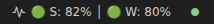
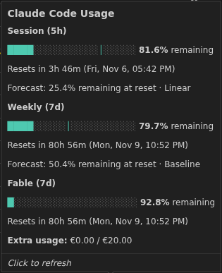
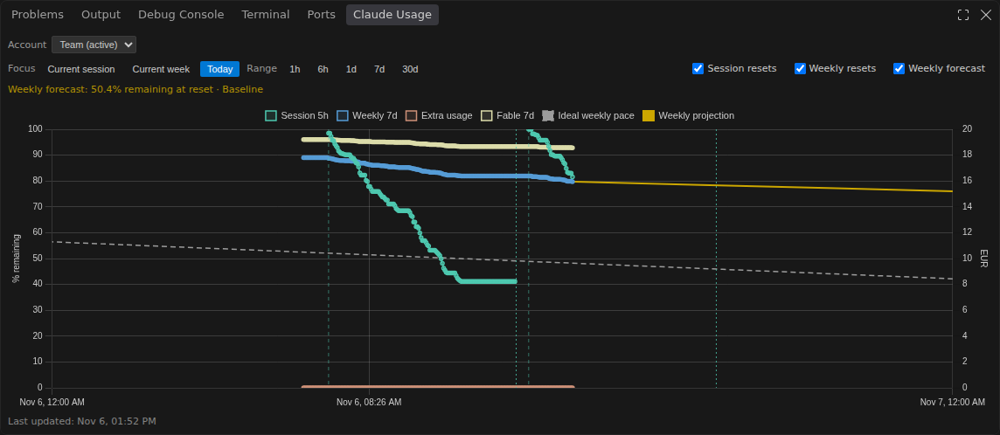
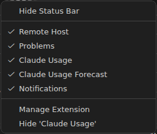
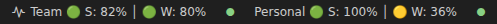

# Claude Code Usage Status - Extension for VS Code

Marketplace: [https://marketplace.visualstudio.com/items?itemName=mhelbich.claude-code-usage-status](https://marketplace.visualstudio.com/items?itemName=mhelbich.claude-code-usage-status)

A simple VS Code extension that shows your [Claude Code](https://claude.ai/code) session and weekly usage directly in the status bar — so you always know how much capacity you have left before hitting a limit.







## Features

- **Status bar indicator**: remaining usage for the current 5-hour session and the 7-day window, color-coded by how much is left, plus a dot for the weekly forecast
- **Rich tooltip**: hover to see usage bars with forecast markers, exact remaining %, relative and absolute reset times, extra usage spend, model-specific limits, and the weekly split by surface
- **Usage History panel**: a time-series chart in the bottom panel, next to Terminal and Output
- **Adaptive weekly forecast**: a regularized baseline avoids noisy early-week extrapolation, then recent personal weekly patterns are weighed in. The projection is shared by the history panel, the tooltip and the status bar dot
- **Multiple accounts**: follows the config dir Claude Code uses in each VS Code profile, or shows several accounts side by side
- **Auto-refresh**: polls on a configurable interval (default: every 2 minutes); click the status bar item to refresh immediately
- **Customizable thresholds**: configure when the indicator turns yellow or red

### Status bar

```
⚡ 🟢 S: 82%  │  🟢 W: 59%  ●
```

- `S` = session (5-hour rolling window); hidden on plans without a 5-hour limit (e.g. Ultra)
- `W` = weekly (7-day rolling window)
- Percentage = **remaining** capacity by default; set `claudeUsage.showUsed` to `true` to flip to **used** %
- 🟢 plenty of headroom · 🟡 getting low · 🔴 almost out
- `●` = weekly forecast: green on track, yellow tight, red likely to hit the limit before the reset
- `✗` = not logged in (run `claude /login`) · `!` = API error (hover for details) · greyed out = last known usage, see [When a token has expired](#when-a-token-has-expired)

**Hiding items:** Right-click the status bar and uncheck **Claude Usage** or **Claude Usage Forecast**. With several accounts, each account's items are listed separately, e.g. **Claude Usage Forecast (Team)**.



### Tooltip

Hovering shows a detailed breakdown with colored usage bars, forecast markers where available, remaining percentage, and reset times, e.g. "2h 15m (Wed, Mar 19, 02:30 AM)". It also shows extra usage spend against its monthly limit in your billing currency, how much of the weekly limit a model-specific limit may use, and, when usage comes from more than one surface, the weekly split between Claude Code, Chats, Cowork, and others.

### Usage History panel

Open the **Claude Usage** tab in the bottom panel. The chart tracks the 5-hour session, the general and model-specific 7-day limits, and extra usage spend in your billing currency.

- **Focus** on the current session, the current week or today, or pick a fixed **Range** (1h, 6h, 1d, 7d, 30d). The selected view persists across reloads.
- **Overlays**: session resets, weekly resets, and the weekly pace and forecast lines. Toggle them in the panel, or set their defaults in the settings.
- **Account**: with several accounts, a dropdown switches between them.

History is stored locally, per account, and kept for `claudeUsage.historyRetentionDays` (30 days by default).

## Requirements

You must be logged in to Claude Code (`claude /login`). The extension reads your local credentials file, so no API key setup is needed.

**Platform support:**

- macOS (reads from Keychain, falls back to `~/.claude/.credentials.json`)
- Linux / WSL (reads from `~/.claude/.credentials.json`)
- Windows (reads from `~/.claude/.credentials.json`)

In remote windows (WSL, SSH, containers), the extension runs on the remote side and reads the credentials there.

## Multiple accounts and config dirs

Claude Code keeps each account in its own config dir: `~/.claude` by default, or the directory in `CLAUDE_CONFIG_DIR`. The extension can follow the account Claude Code uses in a window, or show several accounts at once.

### Following the account of each window

When Claude Code uses another config dir (`CLAUDE_CONFIG_DIR`, or `CLAUDE_SECURESTORAGE_CONFIG_DIR`), the extension reads that dir's credentials instead. It looks at the environment VS Code was started with, overridden by the Claude Code extension's `claudeCode.environmentVariables` setting, following the same rules as that extension (for example, `CLAUDE_CONFIG_DIR` from the setting must be an absolute path). Settings can differ per VS Code profile, so this lets a profile use and show a separate Claude account, for example in a Work profile:

```jsonc
"claudeCode.environmentVariables": [
  { "name": "CLAUDE_CONFIG_DIR", "value": "C:\\Users\\you\\.claude-work" }
]
```

- Claude Code launched in a terminal (including `claudeCode.useTerminal`) uses the shell's environment instead, which the extension can't see.
- In remote windows, add the setting to the remote settings (**Preferences: Open Remote Settings (JSON)**). VS Code ignores it in the local user settings there, because it is a machine-scoped setting.
- Usage history and the weekly forecast are kept separately for each config dir, so accounts don't mix in the History panel. On macOS, the config dir also selects the matching Keychain entry.

### Showing several accounts at once

To see several accounts side by side, for example a team and a personal subscription, list their config dirs in `claudeUsage.accounts`:

```jsonc
"claudeUsage.accounts": [
  { "label": "Team", "configDir": "~/.claude" },
  { "label": "Personal", "configDir": "~/.claude-personal" }
]
```



Each account gets its own labeled status bar items, in list order, with its own tooltip, history and forecast. The account the Claude Code panel in this window uses (see above) is marked with the pulse icon; Claude sessions started in a terminal don't move it. The Usage History panel opens on that account and has a dropdown to switch to the others.

- `configDir` must be an absolute path; `~` is expanded, and an empty value means `~/.claude`.
- The setting can only be set in user settings (or remote settings in remote windows), not in a workspace's settings, so a repository can't point the extension at other directories. Like other user settings, it can differ per VS Code profile; use **Apply Setting to all Profiles** to share it.
- Each account costs one API request per refresh interval, shared across windows through that account's cache file.
- Changes to the setting apply right away, without a reload.

### Logging in to another account

Start Claude Code once with the new config dir and log in:

```bash
CLAUDE_CONFIG_DIR=~/.claude-personal claude   # then /login if it doesn't ask
```

The login opens claude.ai in your browser. If you're already signed in there with another account, sign out first or use a private window. The new config dir starts empty, so your settings, `CLAUDE.md`, plugins and MCP servers from `~/.claude` don't apply there until you copy or link them.

### When a token has expired

Claude Code only renews an account's token while it runs, so an account you haven't used for a while has no valid token. The extension then shows that account's last known usage, greyed out, with the time it was fetched in the tooltip and with any resets that have passed since applied. Once the weekly limit has reset since that fetch, it shows ✗ instead. Using Claude with that account (or `claude /login`) brings it back up to date.

## Settings

| Setting                               | Default | Description                                                        |
| ------------------------------------- | ------- | ------------------------------------------------------------------ |
| `claudeUsage.refreshIntervalSeconds`  | `120`   | How often (in seconds) to poll usage                               |
| `claudeUsage.warningThreshold`        | `60`    | Usage % at which the indicator turns yellow                        |
| `claudeUsage.dangerThreshold`         | `90`    | Usage % at which the indicator turns red                           |
| `claudeUsage.showUsed`                | `false` | Show used % instead of remaining % in the status bar and tooltip   |
| `claudeUsage.historyRetentionDays`    | `30`    | Number of days of usage history to retain in the History panel     |
| `claudeUsage.showSessionResetMarkers` | `true`  | Show session start markers in the History panel                    |
| `claudeUsage.showWeeklyResetMarkers`  | `true`  | Show weekly reset markers in the History panel                     |
| `claudeUsage.showWeeklyForecast`      | `true`  | Show weekly pace and forecast overlays in the History panel        |
| `claudeUsage.showScopedWeeklyLimits`  | `true`  | Show model-specific weekly limits in the tooltip and History panel |
| `claudeUsage.accounts`                | `[]`    | Accounts to show side by side (see [Showing several accounts at once](#showing-several-accounts-at-once)) |

Thresholds are expressed as **used %** (e.g. the default `60` means "warn when 60% has been consumed, i.e. 40% remaining").

## Development

Use the workspace's `Run Extension` or `Watch Extension` launch profile to debug with `F5`. These launch an Extension Development Host, which provides the `vscode` module to the extension at runtime.

`npm run compile` (and `npm run watch`) first runs `scripts/prepare-build.mjs`, which clears `out/` and copies Chart.js's UMD build from `node_modules/chart.js` into `history-view/chart.umd.js`. That file is generated, not committed: the webview may only load scripts shipped inside the extension, so the version pinned in `package-lock.json` is copied on every build. Run `npm install` before the first build.

### Testing

This extension uses the official VS Code extension test tooling (`@vscode/test-cli` + `@vscode/test-electron`) with Mocha-based integration tests.

- Run unit tests with `npm run test:unit`
- Run extension integration tests with `npm run test:vscode`
- Run both with `npm test`
- Debug tests with the workspace's `Extension Tests` launch profile

The test runner downloads VS Code into `.vscode-test/` on first run.

Unit tests cover extracted pure logic such as formatting and rendering helpers. Integration tests cover VS Code-specific wiring, activation, and command behavior.

If `npm test` fails because another VS Code Stable instance is running, either close that instance first or use the `Extension Tests` launch profile from the editor instead.

## How it works

The extension calls the same usage endpoint that Claude Code itself uses (`https://api.anthropic.com/api/oauth/usage`) with the OAuth token stored locally by `claude`, once per account. No data ever leaves your machine beyond that read-only API call.

**Multiple windows:** When more than one VS Code window is open, each instance would otherwise poll independently, quickly exhausting the API rate limit. To avoid this, all instances share a cache file per account: `usage-cache.json` in that account's config dir (`~/.claude/usage-cache.json` by default). Before making a network request, each instance checks whether the cached response is still within its configured refresh interval. If it is, the cached data is used directly and no API call is made. The instance with the shortest configured interval effectively drives the refresh rate for all windows.

## License

MIT
